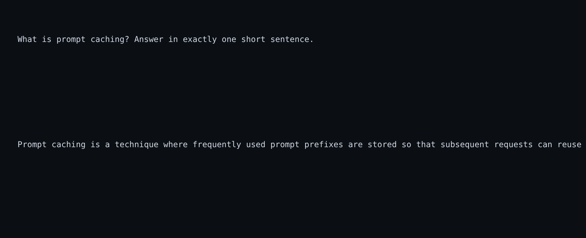

# pi-usage-stats

A [pi](https://github.com/earendil-works/pi-coding-agent) extension that shows **prompt-cache hit rate** and **output token speed** in the footer status bar, updated after every assistant response.



```
cache 87%/91% · 42.3 tok/s · 1.2k out
```

## What it shows

| Segment | Meaning |
|---|---|
| `cache 87%` | Prompt-cache hit rate of the last response: `cacheRead / (input + cacheRead + cacheWrite)` |
| `/91%` | Session-cumulative hit rate across all responses so far |
| `42.3 tok/s` | Average output speed of the last response (output tokens ÷ wall time) |
| `1.2k out` | Output tokens of the last response |

Hit-rate color hints: green ≥ 50%, yellow > 0%, muted when 0.

## Install

With the pi CLI:

```bash
pi install git:github.com/Svtter/pi-usage-stats
```

Or manually copy [`extensions/usage-stats.ts`](extensions/usage-stats.ts) into your user extensions directory and restart pi (or run `/reload`):

```bash
mkdir -p ~/.pi/agent/extensions
cp extensions/usage-stats.ts ~/.pi/agent/extensions/
```

## How it works

The extension subscribes to two message lifecycle events:

- `message_start` records the timestamp when an assistant message begins.
- `message_end` reads `message.usage` (`input`, `output`, `cacheRead`, `cacheWrite`), computes both metrics, and renders them with `ctx.ui.setStatus()`.

## Provider support

Cache hit rate requires the provider to report cache token usage. Works with Anthropic-compatible APIs (Anthropic, Zhipu GLM, DeepSeek, Kimi, OpenRouter, ...). Providers that do not report cache fields will show `cache 0%` while the token speed still works.

## Notes

- `tok/s` includes time-to-first-token and reasoning/thinking tokens (they are part of `output`), so it is a conservative average rather than a pure decode-speed figure.
- A cold start (new session, changed system prompt, or an idle gap longer than the provider's cache TTL) shows as a hit-rate drop on the next response.

## 中文说明

pi 状态栏扩展：显示提示缓存命中率与输出 token 速度。

- `cache 87%/91%` — 最近一条响应的缓存命中率 / 本次会话累计命中率
- `42.3 tok/s` — 最近一条响应的平均输出速度（含首 token 延迟与思考 token）
- `1.2k out` — 最近一条响应的输出 token 数

安装：`pi install git:github.com/Svtter/pi-usage-stats`，或将 `extensions/usage-stats.ts` 复制到 `~/.pi/agent/extensions/` 后重启（或 `/reload`）。

## License

[MIT](LICENSE)
